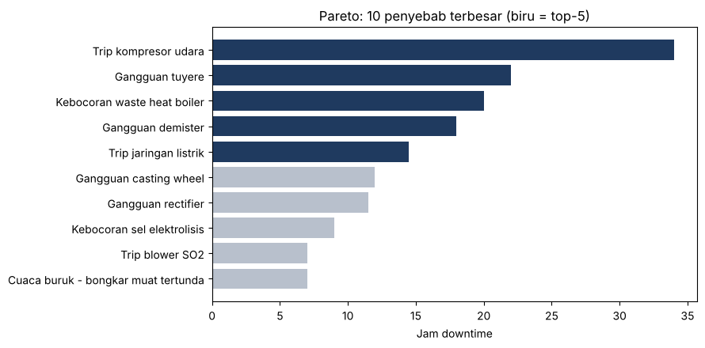

# Analisis Kinerja Smelter dengan Python (Fase 0–3)

Portofolio *Smelter Reporting & Data Analyst*: 13 notebook Python yang mengubah data produksi, downtime, mutu, dan komponen kritis smelter tembaga menjadi insight dan rekomendasi untuk manajemen.
Periode data: 1 Januari – 30 September 2026 (273 hari). Bahasa notebook: Indonesia.

> **Catatan data.** Ini proyek portofolio berbasis *skenario latihan* (terinspirasi operasi smelter tembaga), **bukan data operasional perusahaan mana pun** dan tidak berafiliasi dengan pihak-pihak manapun. Tiga tabel inti (`Data_Harian`, `Downtime_Log`, `QC_Lab`) adalah data skenario; empat tabel lain (`Proses_Harian`, `Produksi_Shift`, `Harga_Biaya`, `Komponen_Kritis`) **disimulasikan** dengan seed tetap. Harga, tarif, biaya program, dan batas spesifikasi adalah angka contoh. Karena itu, angka dolar dan kesimpulan per komponen/shift bersifat ilustratif. Rincian di [`docs/kamus_data.md`](docs/kamus_data.md).

## Temuan utama

| # | Temuan | Dasar |
| --- | --- | --- |
| 1 | Henti tak terjadwal 177,5 jam (2,7% dari 6.552 jam); MTBF pabrik 4,6 hari, MTTR 3,1 jam | Notebook 04 |
| 2 | Oxygen Plant (40,5 jam, MTBF 592 jam) dan Flash Smelting Furnace (27,5 jam, MTBF 593 jam) membawa 38% jam henti | Notebook 04 |
| 3 | Tidak ada tren perburukan: Laplace p = 0,484; Crow-AMSAA β = 1,10 (CI 95% 0,84–1,40). Masalahnya kronis | Notebook 04 |
| 4 | Pada Juni–Juli, trip kompresor udara = 23 dari 80,5 jam henti tak terjadwal | Downtime_Log (analisis tambahan) |
| 5 | Off-grade 7,9% setelah ada henti dalam 3 hari terakhir vs 2,5% tanpa henti (Fisher p = 0,062): indikasi, belum terbukti | Analisis tambahan |
| 6 | Energi per ton: model Ridge walk-forward RMSE 0,033 vs baseline 0,067 MWh/t (R² 0,72; hold-out 0,63). Penentu utama: suhu FSF, O2 enrichment, jam downtime | Notebook 11 |
| 7 | Penggantian terjadwal layak untuk Blower SO2 (β = 4,2; interval optimal 273 hari, ±20% jam hilang berkurang); tuyere, demister, rectifier tidak layak | Notebook 09, 12 |
| 8 | Tidak ada perbedaan shift/regu yang bertahan setelah koreksi uji ganda (p Holm 0,25–0,43) | Notebook 10 |
| 9 | Tidak ada pergeseran proses: energi per ton 0 titik perubahan; titik perubahan recovery adalah artefak pencilan | Notebook 07 |

Rekomendasi, kebijakan, rencana 30-60-90 hari, dan daftar "hal yang tidak boleh disimpulkan" ada di [`docs/ringkasan_eksekutif.md`](docs/ringkasan_eksekutif.md).



## Isi notebook

| Fase | Notebook | Teknik | Pertanyaan yang dijawab |
| --- | --- | --- | --- |
| 0 | [00 Validasi data](notebooks/00_Validasi_Data.ipynb) | 29 uji konsistensi, hitung ulang kolom turunan, deteksi nilai ekstrem | Apakah angkanya bisa dipercaya? |
| 1 | [01 Eksplorasi & replikasi dashboard](notebooks/01_Eksplorasi_Replikasi_Dashboard.ipynb) | KPI, ringkasan bulanan, Pareto, target prorata hari | Apakah hasil Python sama dengan dashboard Power BI? |
| 1 | [02 Inferensial](notebooks/02_Inferensial.ipynb) | Welch, Mann-Whitney, Cohen's d, bootstrap, chi-square, permutasi, Cochran-Armitage, Fisher + Holm | Apakah perbedaan nyata atau kebetulan? |
| 1 | [03 Regresi](notebooks/03_Regresi.ipynb) | OLS dari nol (HC3, VIF, Breusch-Pagan, Durbin-Watson, Jarque-Bera) | Apa yang memengaruhi energi per ton dan recovery? |
| 1 | [04 Keandalan](notebooks/04_Keandalan.ipynb) | MTBF/MTTR, Laplace, Crow-AMSAA, Weibull + sensor + left truncation, B10 | Unit dan komponen mana yang paling sering gagal? |
| 2 | [05 SPC](notebooks/05_SPC.ipynb) | I-MR, aturan Western Electric, EWMA, CUSUM, Cp/Cpk, simulasi ARL | Kapan proses mulai menyimpang? |
| 2 | [06 Monte Carlo](notebooks/06_Monte_Carlo.ipynb) | Poisson + Gamma, bootstrap durasi, common random numbers | Berapa peluang mencapai target dan efek mengurangi downtime? |
| 2 | [07 Titik perubahan](notebooks/07_Titik_Perubahan.ipynb) | PELT buatan sendiri, winsorizing, kontrol negatif, uji permutasi | Apakah ada pergeseran proses? |
| 2 | [08 Deteksi anomali](notebooks/08_Deteksi_Anomali.ipynb) | Robust z, EllipticEnvelope, IsolationForest, LOF, residual regresi, benchmark anomali suntikan | Hari mana yang janggal? |
| 2 | [09 Survival](notebooks/09_Survival.ipynb) | Kaplan-Meier (delayed entry), log-rank, Cox stratifikasi | Berapa umur komponen dan apa pengaruhnya? |
| 3 | [10 Shift & regu](notebooks/10_Shift_Regu.ipynb) | ANOVA/Kruskal/Friedman, uji dua faktor, permutasi, power/MDE, Holm | Apakah shift atau regu berbeda? |
| 3 | [11 Prediksi energi](notebooks/11_Prediksi_Energi.ipynb) | Ridge, Random Forest, Gradient Boosting, TimeSeriesSplit, permutation importance, conformal, what-if | Seberapa besar energi bisa dihemat? |
| 3 | [12 Optimasi penggantian](notebooks/12_Optimasi_Penggantian.ipynb) | Biaya age-replacement, Monte Carlo kebijakan, sensitivitas rasio biaya | Kapan komponen sebaiknya diganti? |

Semua notebook sudah berisi keluaran (tabel dan grafik), sehingga dapat dibaca langsung di GitHub tanpa menjalankan apa pun.

## Cara menjalankan

**Google Colab (tanpa instalasi).** Buka notebook dari GitHub (`File > Open notebook > GitHub`) atau gunakan tautan
`https://colab.research.google.com/github/USERNAME/smelter-analytics/blob/main/notebooks/00_Validasi_Data.ipynb`
(ganti `USERNAME`). Jalankan sel pertama; bila berkas data belum ada, Colab menampilkan dialog unggah. Pilih `data/Smelter_Data_Lanjutan.xlsx`. Locale tidak perlu diubah.

**Lokal.**
```bash
git clone https://github.com/USERNAME/smelter-analytics.git
cd smelter-analytics
python -m venv .venv && source .venv/bin/activate      # Windows: .venv\Scripts\activate
pip install -r requirements.txt
pip install jupyterlab && jupyter lab notebooks/
```

**Membangun ulang semua notebook dan grafik** dari sumber `notebooks_src/*.py`:
```bash
python scripts/build_notebooks.py          # menulis notebooks/*.ipynb dan reports/figures/*.png
python scripts/build_notebooks.py --check  # hanya menguji bahwa semua modul berjalan
```

**Membangun ulang data simulasi** (hasilnya identik, seed 2026):
```bash
python scripts/generate_data.py
```

## Struktur repositori

```
smelter-analytics/
├── data/
│   ├── Smelter_Data_Lanjutan.xlsx     # 8 sheet (3 skenario + 4 simulasi + kunci)
│   └── raw/                            # CSV Data_Harian, Downtime_Log, QC_Lab
├── notebooks/                          # .ipynb lengkap dengan keluaran
├── notebooks_src/                      # sumber .py format "# %%" (mudah di-diff)
├── scripts/                            # build_notebooks.py, generate_data.py
├── reports/figures/                    # semua grafik .png
├── docs/                               # kamus_data.md, ringkasan_eksekutif.md
├── .github/workflows/ci.yml            # uji otomatis semua notebook
├── requirements.txt
└── LICENSE
```

## Batasan

- Data proses, shift, komponen, dan biaya disimulasikan; hubungan sebab-akibat belum teruji (hanya asosiasi pada data observasi).
- Sampel per unit/komponen kecil (3–11 kejadian), sehingga selang kepercayaan lebar.
- Notebook 03 memuat sel opsional pencocokan dengan `statsmodels` yang hanya berjalan bila paket itu terpasang.
- Algoritma statistik (OLS, PELT, Cox, dsb.) ditulis dari nol demi pembelajaran. Untuk produksi, gunakan pustaka mapan seperti `statsmodels`, `lifelines`, dan `ruptures`.

## Pengembangan berikutnya

Data historian dan CMMS nyata, biaya resmi dari Finance, periode 24–36 bulan, uji A/B untuk setpoint suhu/O2, model hierarkis untuk unit dan regu, model risiko berulang, pipeline terjadwal ke Power BI, dan pemantauan drift model.

## Lisensi

Kode: MIT (lihat `LICENSE`; akbarparsan). Data: skenario latihan untuk keperluan belajar dan portofolio.
